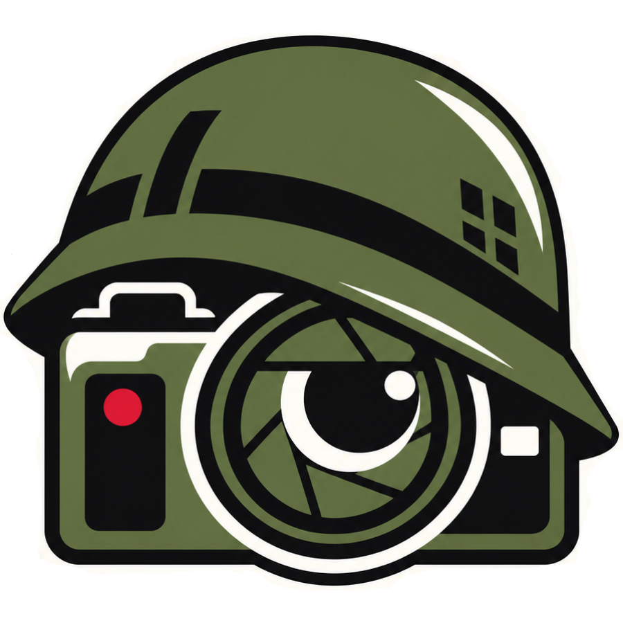

# SARGE Desktop · Beta



**Scole’s Archive of RAWs, Galleries & Exports**  
*Reporting for photo duty*

[**Download Windows Beta 0.3.0-beta.1**](https://github.com/natsteff/SARGE-Desktop/releases/tag/v0.3.0-beta.1) · [All releases](https://github.com/natsteff/SARGE-Desktop/releases) · [Setup and usage](desktop/README.md)

SARGE inventories photos across local folders, USB drives and external disks. Keep searchable details and optional previews when drives are offline, match Canon CR2 originals to JPG/PNG exports, and copy selected categories without overwriting different files.

Windows 10/11 x64 is the primary target. No Docker, Python, helper, or ExifTool installation is required. macOS is a bonus development target. This beta installer is unsigned and needs further hands-on testing.

## Features

- Register multiple drives or folders with nicknames, descriptions, volume identity and dates extracted from folder names.
- Scan nested folders without a depth limit; directory links are not followed.
- Match RAW identifiers in export filenames and parent folders; review suggestions and confirm relationships manually.
- Search and sort inventory, customize columns for saved EXIF details, and export CSV.
- Keep metadata and optional previews in the local SQLite catalog for offline browsing.
- Open original photos or reveal them in Explorer when their source is available.
- Run Scan only, Scan and copy, or Copy only on an individual source or all available registered sources. Confirm before skipping offline sources.
- Copy matched, unmatched or both categories, preserving folders, verifying SHA-256 and protecting existing different files.
- View online/offline counts, hide offline location cards, and monitor scan activity.
- Back up the catalog, cached previews and preferences in one archive with restore instructions.

## Appearance and screenshots

Use **Appearance** in the sidebar to switch between **SARGE · Default**, with light backgrounds and olive accents, and **Solly’s Soldiers · Dark**, with white text and red, blue and green accents. The logo changes with the theme. Your choice is remembered on this computer.

Updated screenshots from the Windows desktop application are pending capture. The old Docker screenshots are intentionally omitted because they show a different application. Planned examples use the default theme for inventory, drives and scan activity, plus one Solly’s Soldiers theme example. See the [capture checklist](docs/SCREENSHOTS.md).

## Updating from the desktop alpha

Fully close SARGE and back up your catalog before installing. The database location is unchanged:

```text
%APPDATA%\io.github.natsteff.sarge.desktop
```

The app is now named **SARGE Desktop** rather than **SARGE Desktop Alpha**. If Windows retains the old Alpha installation, uninstall that entry with **Delete app data unchecked**, then use SARGE Desktop. Both versions use the same catalog; do not run them simultaneously. Your original photos are separate from the catalog and remain untouched.

Existing inventories need a rescan to collect the newest metadata fields. Preview generation is optional and can be enabled in Preview settings.

## Development

```sh
git clone https://github.com/natsteff/SARGE-Desktop.git
cd SARGE-Desktop/desktop
pnpm install --frozen-lockfile
pnpm dev
```

Developers need Rust stable, Node.js 22+, pnpm and the platform build tools. GitHub Actions tests Windows/macOS and builds the Windows installer. Development can continue on either platform. [Detailed instructions](desktop/README.md).

This independent repository starts from the desktop implementation developed in the earlier SARGE project, through commit `ecca779`. The Docker application is preserved in that separate repository and is no longer the focus of development. No Docker services, scanner helpers or inventory import scripts are included here.

AGPL-3.0-only. See [LICENSE](LICENSE).
