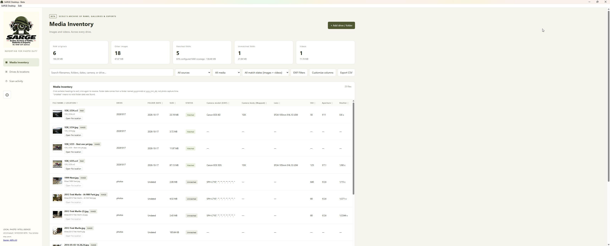
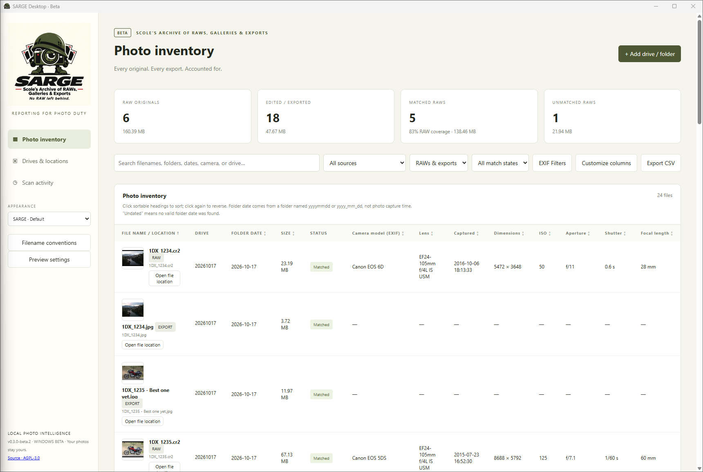
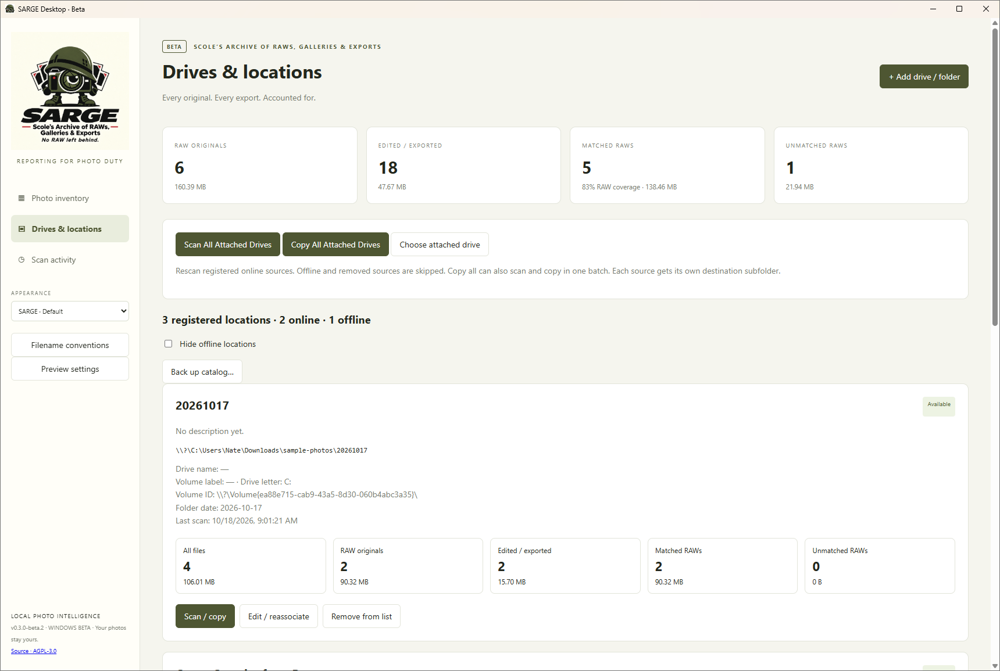
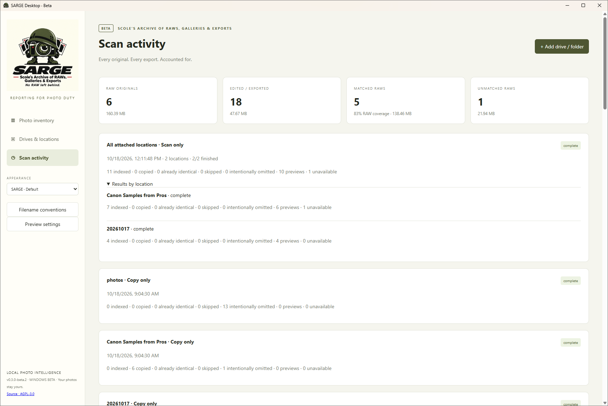
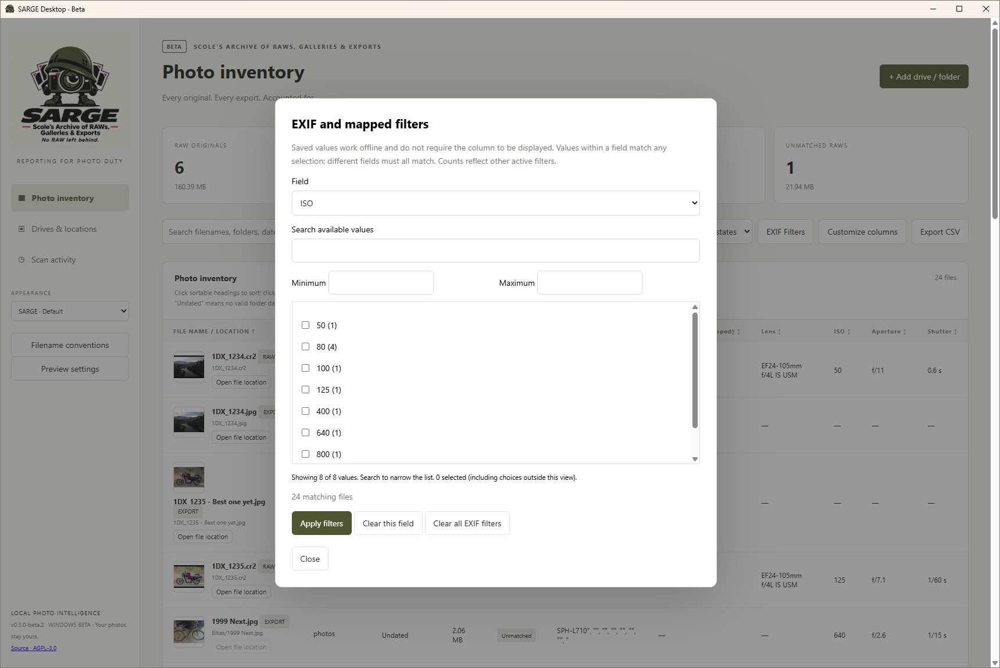
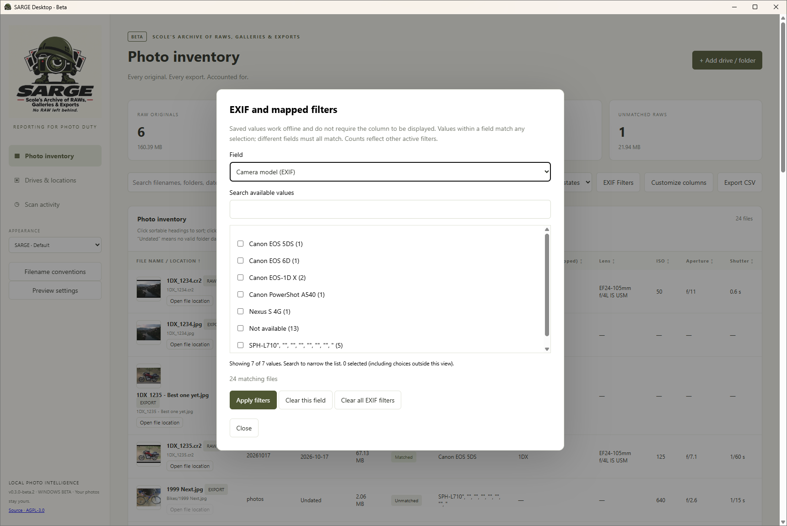
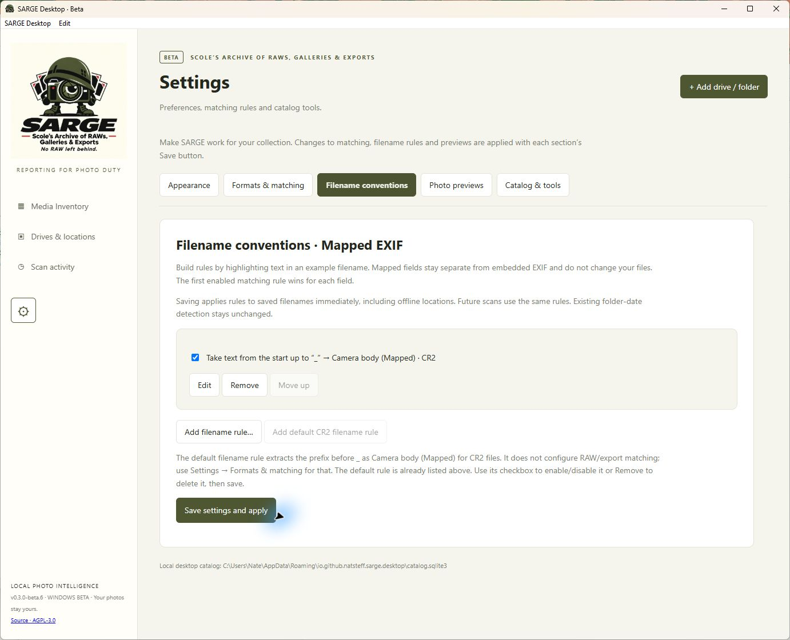
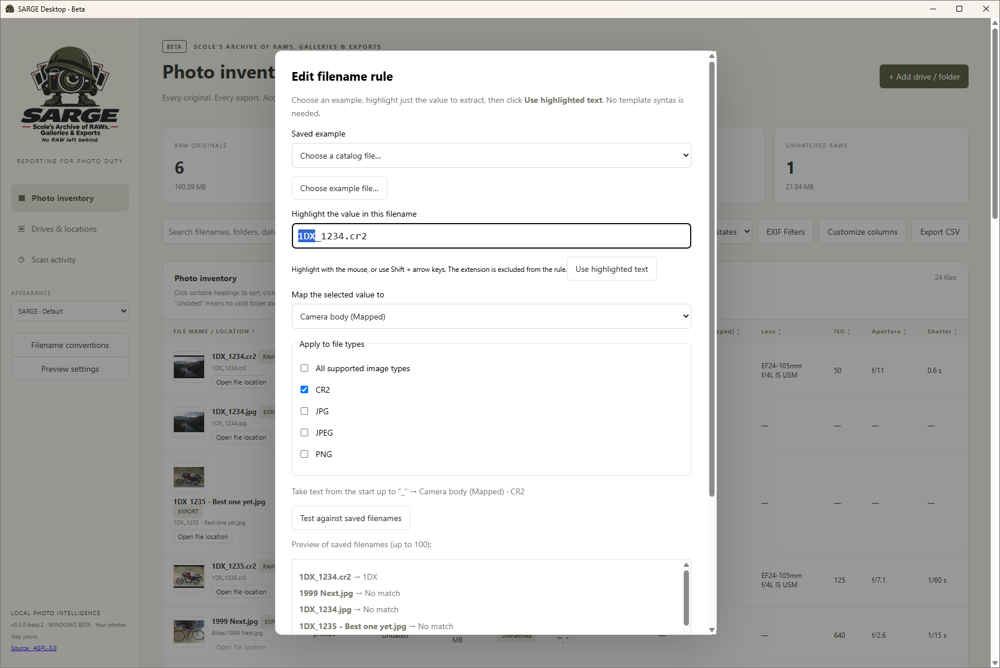
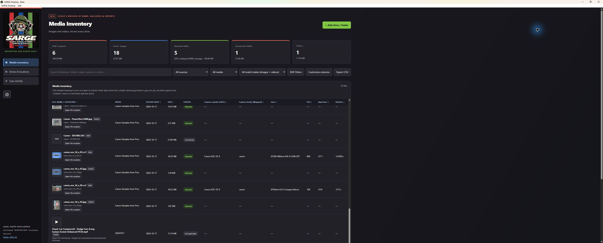

# SARGE Desktop · Beta

**Scole’s Archive of RAWs, Galleries & Exports**  
*Reporting for photo duty*

[**Download Windows Beta 0.3.0-beta.5**](https://github.com/natsteff/SARGE-Desktop/releases/tag/v0.3.0-beta.5) · [All releases](https://github.com/natsteff/SARGE-Desktop/releases) · [Setup and usage](desktop/README.md)

SARGE’s main purpose is to **inventory photo images across multiple drives**, including USB and external drives that are currently disconnected. It focuses on **matching Canon RAW (CR2) originals to JPG exports**, keeping detailed per-image records and aggregate counts and sizes across your collection. Copy matched RAWs and exports—or unmatched files—to selected destinations to support storage and space-saving management. Copies are verified; SARGE does not delete your originals or reclaim space automatically.

Windows 10/11 x64 is the primary target. No Docker, Python, helper, or ExifTool installation is required. macOS is a bonus development target. This beta installer is unsigned and needs further hands-on testing.

## Windows security warnings

SARGE’s current beta releases are **unsigned**. Depending on your Windows settings and Microsoft’s reputation checks, you may see a security warning. Some installations won’t show one.

Download installers only from the [official SARGE Desktop releases](https://github.com/natsteff/SARGE-Desktop/releases).

- **“Windows protected your PC” — Microsoft Defender SmartScreen:** select **More info → Run anyway**, if that option is available and you trust the downloaded installer.
- **“Smart App Control blocked this app”:** Smart App Control has no per-app exception. You can wait for a signed release or choose to turn it off under **Windows Security → App & browser control → Smart App Control settings**. Turning it off affects protection for your entire PC; the ability to turn it back on depends on your Windows version and updates. See [Microsoft’s Smart App Control guidance](https://support.microsoft.com/en-us/windows/security/threat-malware-protection/smart-app-control-frequently-asked-questions) before changing this setting.

If **Microsoft Defender Antivirus reports a named threat**, don’t assume it is the same warning. Stop and [report the detection](https://github.com/natsteff/SARGE-Desktop/issues), including the release version and detection name.

## Features

- Register multiple drives or folders with nicknames, descriptions, volume identity and dates extracted from folder names.
- Scan nested folders without a depth limit; directory links are not followed.
- Match RAW identifiers in export filenames and parent folders; review suggestions and confirm relationships manually.
- Sort every optional metadata column, customize actual and mapped EXIF columns, and export CSV. **EXIF Filters** provides searchable catalog-derived choices, missing values and numeric/date ranges, including offline sources.
- Read shutter speeds in conventional form, such as **0.6 s** or **1/250 s**, while keeping numeric precision for sorting and filtering.
- Build filename mappings visually in **Filename conventions**, using an example file, highlighted text, field picklists and file-type checkboxes. The default CR2 rule maps the prefix before `_` to Camera body (Mapped), separately from actual EXIF.
- Keep metadata and optional previews in the local SQLite catalog for offline browsing.
- Open original photos or reveal them in Explorer when their source is available.
- Run Scan only, Scan and copy, or Copy only on an individual source or all available registered sources. Confirm before skipping offline sources.
- Copy matched, unmatched or both categories, preserving folders, verifying SHA-256 and protecting existing different files.
- View prominent online/offline counts and per-location file/RAW/export/matched/unmatched counts and sizes, including offline catalogs.
- Monitor bulk scan/copy operations as one activity block with aggregate progress and expandable location results.
- Back up the catalog, cached previews and preferences in one archive with restore instructions.

## Appearance and screenshots

Open **Settings → Appearance** using the sidebar gear or **SARGE Desktop → Settings…** in the application menu to switch between **SARGE · Default**, with light backgrounds and olive accents, and **Solly’s Soldiers · Dark**, with white text and red, blue and green accents. The logo changes with the theme. Your choice is remembered on this computer.

These screenshots show the installed Windows **0.3.0-beta.2** with a sample photo catalog. Standard examples use the default theme; the final example shows Solly’s Soldiers · Dark. See the [capture checklist](docs/SCREENSHOTS.md).

Photo inventory shows previews, RAW/export matches, sortable EXIF columns and filename-derived values. **Camera model (EXIF)** and **Camera body (Mapped)** are separate: the example shows Canon EOS 6D alongside the filename label `1DX`. Shutter speeds display as readable values such as **0.6 s** and **1/60 s**.

More saved metadata columns

Choose additional columns for capture time, dimensions, ISO, aperture, shutter speed and focal length. Saved values remain available when the source drive is disconnected.

Drives & locations highlights registered, online and offline totals. Each location has file counts and sizes for all indexed images, RAW originals, edited/exported files, matched RAWs and unmatched RAWs.

Bulk operations appear as one activity block with combined results. Expand **Results by location** to inspect individual sources; older history without a recorded batch identity remains separate.

**EXIF Filters** provides searchable values and counts from the saved catalog, plus numeric or date ranges where applicable. Filters work independently of displayed columns and combine with source, file-type and match-state filters.

Filter by camera model or missing metadata

Select one or more actual camera models or **Not available**. Mapped filename fields are separate choices in the same field selector.

**Filename conventions** manages rules for mapped fields without changing embedded EXIF or original files. The enabled default extracts the prefix before `_` as **Camera body (Mapped)** for CR2 files. Rules can be edited, disabled, removed and reordered; saving reapplies them to saved filenames, including offline locations.

Build a rule visually: choose an example, highlight the desired value, select its mapped field and applicable file types, then test the results. Here `1DX_1234.cr2` produces `1DX`, while JPG files do not match the CR2-only rule.

The same inventory in **Solly’s Soldiers · Dark**, with its alternate logo and the Appearance switcher visible.

## Development disclaimer

SARGE Desktop was developed using **OpenAI Codex**, with human direction and review. AI-assisted development and automated tests do not guarantee error-free behavior. Scan and copy workflows have been tested on small collections. We are now seeking results and feedback from larger-scale use. Keep backups when using SARGE for storage management.

AGPL-3.0-only. See [LICENSE](LICENSE).
